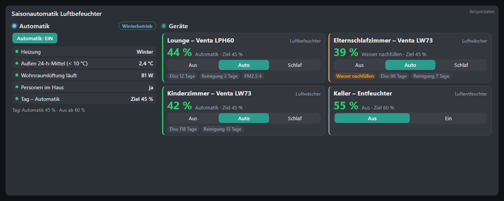
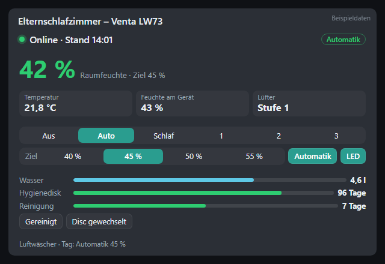
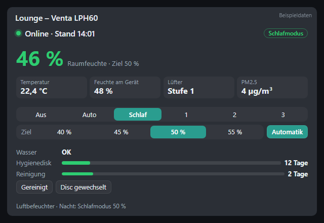

# Venta Lokal für IP-Symcon

Lokale Einbindung von **Venta-Luftbefeuchtern, -Luftwäschern und -Luftreinigern** – ohne Cloud, ohne Konto – dazu
**beliebige Luftentfeuchter** an einer schaltbaren Steckdose, mit Saisonautomatik und Hauptkachel.

| Modul | Zweck |
|---|---|
| **Venta Humidifier** | ein Venta-Gerät; die Instanz ist eine Kachel mit Knöpfen |
| **Generic Dehumidifier** | beliebiger Entfeuchter über Schaltvariable, optional Leistungsmessung (Tank voll) |
| **Venta Automation** | Saisonautomatik für alle Geräte und Hauptkachel |

 

## Geräte

| Protokoll | Geräte | Getestet |
|---|---|---|
| v0 – TCP-Port 48000 | LP60, **LPH60**, LW60(T), LW62(T), AP902/AH902/AW902 | LPH60 |
| v2 – HTTP | **LW73**/LW74, LP73/LP74 | LW73 |

Automatisch erkannt. Nicht unterstützt: reine Tuya-Cloud-Geräte (ab Ende 2024) und Protokoll v3 (AH5xx, AS1xx).

## Funktionen

* Feuchte, Temperatur, Wasserstand, Lüfter, PM2.5, Warnungen im Klartext; Modus, Ziel-Luftfeuchte, LED
* Wartung (Hygienedisk, Reinigung) mit Resttagen und Reset-Knöpfen
* Fehlwerte (255/65535) werden verworfen, Offline-Erkennung, Geräte ohne Verbindung nur alle 10 min gefragt
* Saisonautomatik: Heizung auf Winter + Außen-24-h-Mittel < 10 °C (endet > 14 °C) + Lüftung läuft →
  Tag Automatik 45 %, Nacht Schlafmodus 50 %; Schimmelschutz ab 60 %; Entfeuchter über 60 % außerhalb des Winters;
  manuelle Bedienung hat 4 h Vorrang
* Benachrichtigungen (Kachel-Push oder eigenes Skript): Wasser, Tank voll, Wartung fällig, offline

## Einrichtung

1. Module Store: **Venta Lokal**.
2. Je Gerät eine **Venta Humidifier** (IP-Adresse, Protokoll Automatik). **v0-Geräte (LPH60 …)** einmal freigeben: solange
   die Instanz *Freigabe am Gerät nötig* zeigt, am Gerät kurz die WLAN-Taste antippen.
3. Optional **Generic Dehumidifier** (Schaltvariable, Feuchtesensor, Leistungsmessung).
4. Eine **Venta Automation**: Geräte eintragen, Bedingungsvariablen wählen, auf eine Kachelseite legen und einschalten.

Benachrichtigungsskript: `$_IPS['ACTION']` add/remove, `EVENT`, `TITLE`, `TEXT`, `INSTANCE`; der Rückgabewert von add
kommt als `RESULT` zurück. Funktionen: `VENTA_SetMode`, `VENTA_SetTargetHumidity`, `VENTA_SetLED`, `VENTA_ResetDisc`,
`VENTA_ResetCleaning`, `VENTA_GetState`, `VENTAD_SetPower`, `VENTAA_Update`.

Die lokale Schnittstelle ist nicht dokumentiert; Grundlage sind [ha-venta](https://github.com/Michsior14/ha-venta) und
eigene Tests. v0-Geräte übernehmen nur ein Feld je Befehl (erledigt das Modul).

MIT-Lizenz. Venta ist eine Marke der Venta-Luftwäscher GmbH; keine Verbindung zu Venta.
