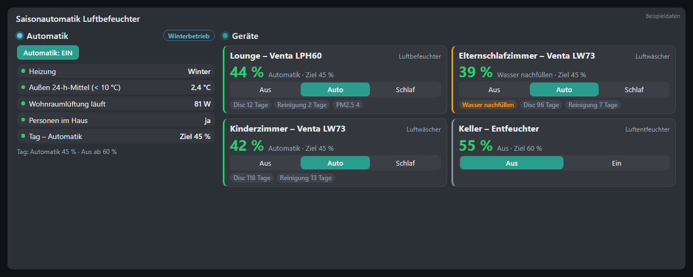
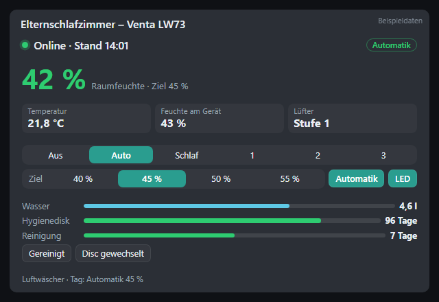
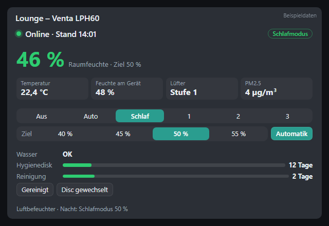

# Venta Lokal for IP-Symcon

Local integration of **Venta humidifiers, air washers and air purifiers** – no cloud, no account – plus **any dehumidifier**
on a switchable plug, with a season automation and a main tile. **Deutsch:** [README.de.md](README.de.md)

| Module | Purpose |
|---|---|
| **Venta Humidifier** | one Venta device; the instance is a tile with buttons |
| **Generic Dehumidifier** | any dehumidifier via a switch variable, optional power measurement (tank full) |
| **Venta Automation** | season automation for all devices and the main tile |

 

## Devices

| Protocol | Devices | Tested |
|---|---|---|
| v0 – TCP port 48000 | LP60, **LPH60**, LW60(T), LW62(T), AP902/AH902/AW902 | LPH60 |
| v2 – HTTP | **LW73**/LW74, LP73/LP74 | LW73 |

Detected automatically. Not supported: Tuya-cloud-only devices (from late 2024) and protocol v3 (AH5xx, AS1xx).

## Features

* Humidity, temperature, water level, fan, PM2.5, warnings in plain text; mode, target humidity, LED
* Maintenance (hygiene disc, cleaning) with remaining days and reset buttons
* Error values (255/65535) are discarded, offline detection, offline devices asked only every 10 min
* Season automation: heating in winter mode + 24 h outdoor mean < 10 °C (ends > 14 °C) + ventilation running →
  day automatic 45 %, night sleep 50 %; mould protection from 60 %; dehumidifiers on above 60 % outside the season;
  manual operation has priority for 4 h
* Notifications (tile push or own script): water, tank full, maintenance due, offline

## Setup

1. Module Store: **Venta Lokal**.
2. One **Venta Humidifier** per device (IP address, protocol automatic). **v0 devices (LPH60 …)** must be authorized once:
   while the instance shows *Authorization on the device required*, briefly tap the WLAN key on the device.
3. Optional **Generic Dehumidifier** (switch variable, humidity sensor, power measurement).
4. One **Venta Automation**: add the devices, select the condition variables, put it on a tile page and switch it on.

Notification script: `$_IPS['ACTION']` add/remove, `EVENT`, `TITLE`, `TEXT`, `INSTANCE`; the return value of add comes
back as `RESULT`. Functions: `VENTA_SetMode`, `VENTA_SetTargetHumidity`, `VENTA_SetLED`, `VENTA_ResetDisc`,
`VENTA_ResetCleaning`, `VENTA_GetState`, `VENTAD_SetPower`, `VENTAA_Update`.

The local interface is undocumented; based on [ha-venta](https://github.com/Michsior14/ha-venta) and own tests. v0 devices
accept only one field per command (handled by the module).

## Changelog

* 1.3 – tiles leave room for the tile title, spread over the full height; LED variable for v2 devices before the first contact
* 1.2 – reset buttons and maintenance intervals as variables
* 1.1 – main tile, Generic Dehumidifier, air purifiers, warnings in plain text
* 1.0 – first version

MIT license. Venta is a trademark of Venta-Luftwäscher GmbH; not affiliated with Venta.
